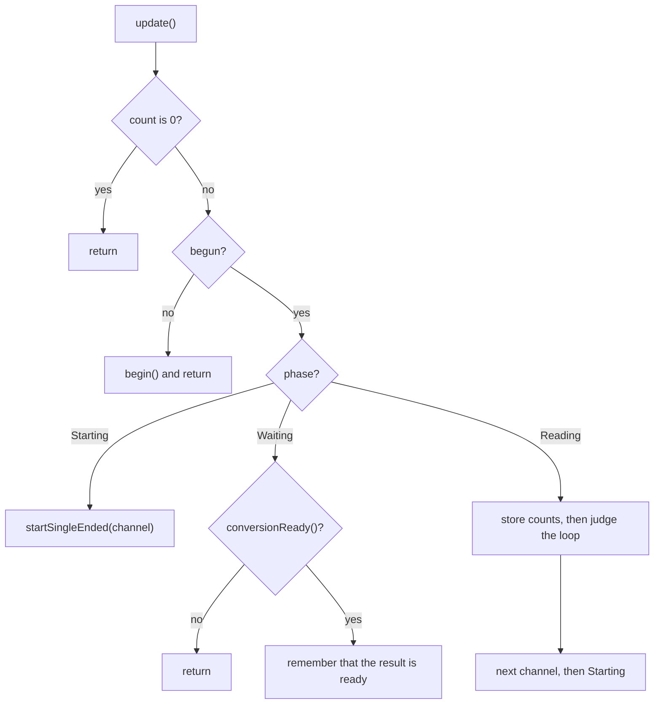

# Sensor inputs

[Home](home.md) · Reference: [Sensor inputs](reference/sensor-inputs.md)

## Summary

`SensorInputs` scans the ADS1115 and keeps the latest counts for each
input. The same object owns that sensor's loop switch. A sensor is
off, on, fault, or disconnected. `ModuleLink` reads the cache and the
state. The scan runs from `loop()`. The TWI1 handler does not talk to
the ADC. It may turn a loop on, off, reset a fault, or read the
fault list.

## Where it sits

`main.cpp` constructs it with `AvrAds1115`, `AvrSensorSwitchPort`,
`AvrInterruptMask`, `SENSOR_COUNT`, `SENSOR_CONNECTED_MIN_COUNTS`,
`SENSOR_TRIP_COUNTS`, and `SENSOR_TRIP_SAMPLES`. `loop()` calls
`update()` and then `moduleLink.update()`. The link does not call
`update()`.

## What it creates

```text
SensorInputs
  IAds1115           begin, start, poll, read
  ISensorSwitchPort  setOn
  IInterruptMask     lock, unlock
```

On this board the count is 3. Index 0 is Sens1 on AIN0, index 1 is
Sens2 on AIN1, and index 2 is Sens3 on AIN2. AIN3 is unconnected.
`SENSOR_SW1_PIN`, `SENSOR_SW2_PIN`, and `SENSOR_SW3_PIN` are the
matching loop switches. High closes the loop.

## One update



One `update()` makes one driver call. The first sample is a begin, a
start, a ready poll, and a read. Each later sample is a start, a poll,
and a read.

## What is stored, and who reads it

The constructor stores the count, the connected threshold, the trip
counts, and how many consecutive trip samples latch a fault. Every
loop starts open. `update()` stores the latest counts. The state is
off until `SET_SENSOR` on. After the loop closes, the next stored
sample sets on, disconnected, or a fault strike.

The valid flag for that input is cleared before the counts are
written and set after them. `ModuleLink` reads an input from the TWI1
handler only while its flag is set. Until the first stored conversion,
a presence or reading reply is `Busy`. `GET_SENSOR_STATE` is `Busy`
from the close until that next sample. `readFault` is what
`GET_FAULT` reads. The reason and the index are on the
[reference](reference/sensor-inputs.md).

## See also

- [Sensor inputs reference](reference/sensor-inputs.md) — phases, the threshold, tests.
- [ADC port](adc-port.md)
- [Module link](module-link.md)
- [Architecture](architecture.md)
